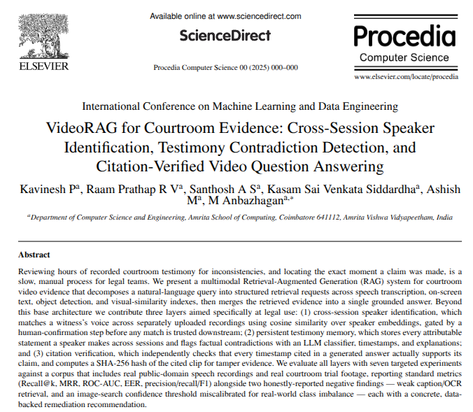
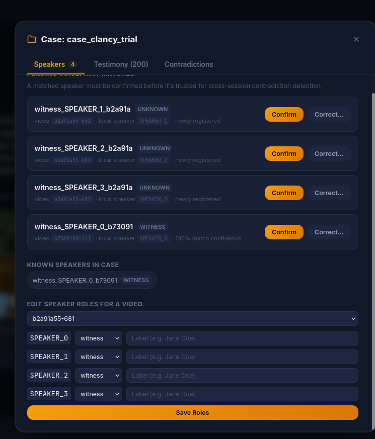
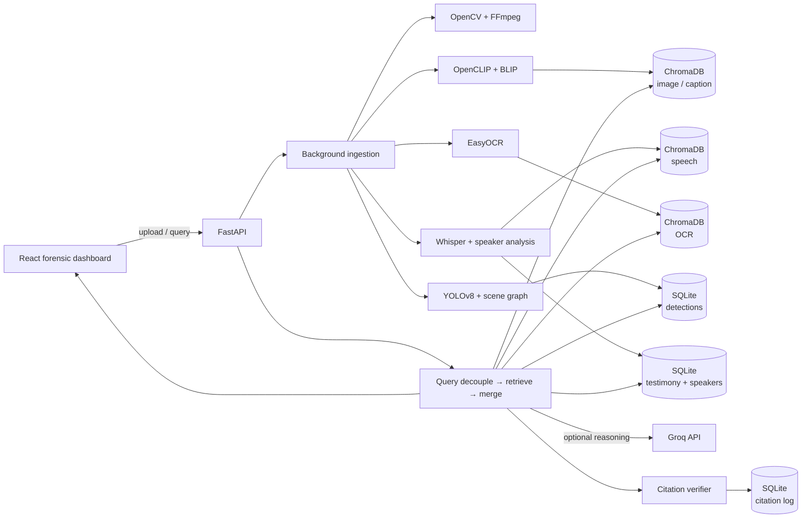

<div align="center">

# VideoRAG

**Multimodal retrieval-augmented generation for courtroom video evidence**



</div>

VideoRAG is a full-stack forensic video analysis system. It ingests evidence
videos, builds local visual, speech, caption, and OCR indexes, stores structured
object and testimony data, and answers natural-language questions with links
back to the relevant video timestamps.

The media-processing pipeline runs locally. Groq is used for query
decomposition, answer synthesis, contradiction classification, and citation
verification when `GROQ_API_KEY` is configured; the application has local
fallback behavior for several query and speaker-analysis paths.

> [!NOTE]
> A complete, code-derived architecture and module report is available as
> [`docs/VideoRAG_Technical_Stack_and_Modules.pdf`](docs/VideoRAG_Technical_Stack_and_Modules.pdf)
> with an editable Markdown source at
> [`docs/VideoRAG_Technical_Stack_and_Modules.md`](docs/VideoRAG_Technical_Stack_and_Modules.md).

## Contents

- [Core capabilities](#core-capabilities)
- [Architecture](#architecture)
- [Technology stack](#technology-stack)
- [Processing and query pipelines](#processing-and-query-pipelines)
- [Module inventory](#module-inventory)
- [API surface](#api-surface)
- [Storage model](#storage-model)
- [Configuration](#configuration)
- [Getting started](#getting-started)
- [Evaluation](#evaluation)
- [Operational notes and limitations](#operational-notes-and-limitations)

## Core capabilities

- **Adaptive video ingestion** — streams uploads to disk, reads real video
  metadata, samples scene changes with a uniform-sampling fallback, extracts
  audio, and tracks background task progress.
- **Four local retrieval indexes** — image, scene-caption, speech-transcript,
  and OCR collections persisted in ChromaDB.
- **Visual and language models** — OpenCLIP for image/text embeddings, BLIP or
  CLIP-label captioning, Whisper for ASR, EasyOCR for on-screen text, and YOLOv8
  for object detection.
- **Structured visual reasoning** — object counting and location lookup plus
  rule-based scene-graph relations such as `left of`, `above`, `inside`, and
  `near`.
- **Agentic retrieval** — an LLM-produced JSON query plan routes a question to
  only the relevant speech, visual, caption, OCR, detection, relation, and
  contradiction tools. Direct heuristic fallbacks keep basic retrieval usable
  when the LLM is unavailable.
- **Image-to-video search** — a reference image is embedded with CLIP and
  matched against indexed video frames.
- **Cross-session speaker identity** — pyannote diarization (with a gap-based
  fallback), Resemblyzer voiceprints, a case-wide speaker registry, and
  human-in-the-loop match confirmation.
- **Testimony memory and contradiction detection** — statements are stored by
  case, session, video, speaker, role, and timestamp, then compared across
  sessions using a three-way `CONTRADICT` / `ENTAIL` / `UNRELATED` classifier.
- **Citation verification** — answer timestamps are checked against nearby
  speech, captions, OCR, and frames; verification decisions and SHA-256 clip
  hashes are retained as an audit trail.
- **Forensic dashboard** — React UI for evidence upload, task progress, video
  selection and deletion, text/image chat, timestamped clip playback, speaker
  confirmation, testimony, and contradiction review.



## Architecture


<p align="center"><em>Detailed multimodal ingestion, legal-analysis, answer-synthesis, and user-interface workflow.</em></p>

### Simplified runtime and data-boundary view



### Execution boundaries

- Frames, audio, metadata, model inference, embeddings, ChromaDB, and SQLite
  data are local to the machine running the backend.
- Groq receives the prompts/evidence required by the reasoning stages when its
  API key is enabled. Do not treat the current configuration as fully offline.
- `backend/mcp_server/server.py` is an in-process MCP-style façade. It mirrors
  retrieval operations but does not start a standalone network MCP server.

## Technology stack

| Layer | Technology | Use in this repository |
|---|---|---|
| Language | Python 3.10+ | Backend, ML pipeline, retrieval agent, evaluation |
| API | FastAPI 0.115.6, Uvicorn 0.34.0, Pydantic | HTTP endpoints, schemas, static media serving |
| Upload/config | python-multipart, python-dotenv, aiofiles | Multipart upload and environment loading |
| Frontend | React 19, React DOM 19, Vite 8 | Single-page forensic dashboard |
| Frontend quality | ESLint 9, React Hooks/Refresh plugins | Static checks and development workflow |
| Styling | Plain CSS | Responsive dark forensic UI and component styles |
| LLM | Groq Python client | Query decomposition, synthesis, contradictions, citation checks |
| Default LLM model | `llama-3.3-70b-versatile` | Configured in `backend/config.py`; overridable with `GROQ_MODEL` |
| ASR | OpenAI Whisper | Timestamped speech transcription |
| Image/text embeddings | OpenCLIP `ViT-B-32` | Frame, text, caption, speech, and OCR embeddings |
| Captioning | BLIP base or CLIP label matching | Scene captions and on-demand frame descriptions |
| OCR | EasyOCR | On-screen text extraction |
| Object detection | Ultralytics YOLOv8n | Object classes, bounding boxes, count/location queries |
| Speaker diarization | pyannote.audio 3.1 | Speaker turns; falls back to silence-gap segmentation |
| Voiceprints | Resemblyzer | Case-wide cross-session speaker matching |
| Video processing | OpenCV, imageio-ffmpeg | Metadata, frames, adaptive sampling, audio extraction |
| ML runtime | PyTorch, TorchVision, Pillow, NumPy | Local model execution and image handling |
| Vector store | ChromaDB | Persistent image, caption, speech, and OCR collections |
| Structured store | SQLite | Detections, scene graph, speakers, testimony, contradictions, citations |
| Evaluation | NumPy, Matplotlib, scikit-learn | Metrics and paper-ready figures; evaluation extras are not pinned in `requirements.txt` |
| Paper | LaTeX | Research paper in `paper/paper.tex` |

Dependency pins and minimums are defined in
[`backend/requirements.txt`](backend/requirements.txt) and
[`frontend/package.json`](frontend/package.json).

## Processing and query pipelines

### Video ingestion

`POST /execute` saves the video in 1 MiB chunks and starts a daemon processing
thread. A case ID may be supplied; otherwise `case_<video_id>` is generated.

1. Read duration, resolution, FPS, and frame count into `data/metadata`.
2. Sample frames adaptively by scene change, bounded by
   `MAX_FRAMES_PER_VIDEO`; fall back to uniform extraction on failure.
3. Extract a WAV audio track with the bundled imageio-ffmpeg binary.
4. Batch-embed valid frames with OpenCLIP and index their real timestamps.
5. Generate captions synchronously, asynchronously, or not at all according to
   `CAPTION_MODE`.
6. Run EasyOCR every third valid frame and index extracted text.
7. Run YOLO every second valid frame, persist detections, and derive spatial
   relation triples for frames containing at least two detections.
8. Transcribe audio with Whisper; assign speaker IDs with pyannote or the
   gap-based fallback; infer courtroom roles from cue phrases.
9. If a case is active, extract voiceprints, match/register canonical speakers,
   store testimony, and launch contradiction scanning.
10. Mark the task complete while non-critical caption or contradiction work may
    continue in the background.

OCR, detection, speaker matching, testimony storage, contradiction scanning,
and citation verification are intentionally non-fatal enhancements: failures
are logged without discarding an otherwise usable video index.

### Question answering

1. Resolve the selected video and case scope.
2. Ask Groq for a structured retrieval plan with ASR, visual, caption, OCR,
   detection, relation, contradiction, and answer-type fields; use local
   defaults if decomposition fails.
3. Search the selected ChromaDB collections and/or SQLite tables.
4. Deduplicate and score results, then enrich top frames with stored captions,
   BLIP descriptions, or CLIP-label descriptions.
5. Merge frame, transcript, OCR, object, relation, and testimony evidence.
6. Generate a grounded answer with timestamps, or render a deterministic local
   fallback response when Groq is unavailable.
7. Build deduplicated playable clips around returned timestamps.
8. For text queries scoped to a video, verify answer citations and persist the
   audit records.

## Module inventory

### Backend core and routing

| Module | Responsibility |
|---|---|
| `backend/main.py` | FastAPI application, CORS, static `/frames` and `/video-files` mounts, router registration, root and health endpoints |
| `backend/config.py` | `.env` loading, data directories, model names, collection names, processing limits, ports, and SQLite paths |
| `backend/models.py` | Pydantic request/response models for execution, status, chat, clips, citations, contradictions, videos, and speakers |
| `backend/routers/execute.py` | Chunked upload, in-memory task state, complete ingestion pipeline, and cascading video deletion |
| `backend/routers/status.py` | Processing-task polling |
| `backend/routers/chat.py` | Text chat, reference-image chat, and conversion from agent dictionaries to API schemas |
| `backend/routers/videos.py` | Evidence library metadata and byte-range-friendly video playback redirect |
| `backend/routers/speakers.py` | Per-video role mappings, pending cross-session matches, and human confirmation/correction |
| `backend/routers/testimony.py` | Case testimony and contradiction retrieval |

### Agent and retrieval façade

| Module | Responsibility |
|---|---|
| `backend/agent/agent.py` | Three-stage query decoupling, multimodal routing, evidence merge/synthesis, local answer fallback, clip building, and citation verification handoff |
| `backend/agent/tools.py` | Groq-compatible function schemas for caption, visual, transcript, image, clip, OCR, detection, relation, and contradiction tools |
| `backend/mcp_server/server.py` | In-process MCP-style wrapper around caption, embedding, transcript, clip, and index-stat operations |

### Backend services

| Module | Responsibility |
|---|---|
| `video_processor.py` | Metadata extraction, uniform/adaptive frame sampling, and WAV extraction |
| `embedding_service.py` | Lazy OpenCLIP loading plus image, text, and batch embeddings |
| `captioning_service.py` | BLIP captioning, CLIP-label pseudo-captions, and detailed frame descriptions |
| `transcription_service.py` | FFmpeg path preparation, lazy Whisper loading, and timestamped ASR segments |
| `indexing_service.py` | Persistent ChromaDB collections; index/search/delete operations; path and caption-readiness handling |
| `ocr_service.py` | Lazy EasyOCR loading and strided text/bounding-box extraction |
| `detection_service.py` | Lazy YOLO loading, strided detection, counts, and spatial position helpers |
| `detection_db.py` | SQLite detections and scene-graph persistence/querying |
| `scene_graph_service.py` | Rule-based spatial relations from detection boxes |
| `speaker_service.py` | Diarization, ASR alignment, role heuristics, voiceprints, registry matching, confirmation, and role persistence |
| `testimony_db.py` | Cross-session statement and contradiction storage/retrieval |
| `contradiction_service.py` | Groq three-way statement comparison and background cross-session scans |
| `citation_service.py` | Timestamp extraction, evidence gathering, LLM verification, and SHA-256 clip hashing |
| `citation_db.py` | Citation verification audit log |

### Frontend

| Module | Responsibility |
|---|---|
| `frontend/src/main.jsx` | React application bootstrap |
| `frontend/src/App.jsx` | Top-level selection, modal, case-panel, sidebar, and clip-player state |
| `frontend/src/api/client.js` | Upload, polling, chat, evidence, deletion, speaker, testimony, and contradiction API calls |
| `components/Sidebar.jsx` | Evidence library, active-video scope, case badges, delete action, and upload entry point |
| `components/UploadModal.jsx` | Drag/drop validation, 500 MiB client limit, case ID, upload progress, and processing polling |
| `components/ChatWindow.jsx` | Text/reference-image composer, scoped queries, message state, and evidence result handling |
| `components/MessageBubble.jsx` | Lightweight Markdown-style answer rendering plus clips, sources, citations, and contradiction cards |
| `components/VideoPlayer.jsx` | Selected-clip playback, seeking, timestamp formatting, and frame gallery |
| `components/CasePanel.jsx` | Speaker-match confirmation/rename, role editing, testimony list, and contradiction review tabs |
| `components/StatusBadge.jsx` | Processing/ready/failed/missing indicator |
| `*.css`, `index.css`, `App.css` | Component styles, theme tokens, layout, responsive behavior, and animations |

### Evaluation, tests, and paper

| Module | Responsibility |
|---|---|
| `evaluation/scripts/eval_01_timestamp_fidelity.py` | Real-timestamp correctness and pre-fix drift reconstruction |
| `eval_02_retrieval.py` | Recall@k and MRR for speech, caption, and OCR retrieval |
| `eval_03_image_search.py` | Image-to-video ROC, precision-recall, EER, and threshold behavior |
| `eval_04_speaker_verification.py` | Pairwise voiceprint similarity and threshold evaluation |
| `eval_05_contradiction_detection.py` | Three-class contradiction metrics and confusion matrix |
| `eval_06_citation_verification.py` | Supported/unsupported citation accuracy versus a trust-all baseline |
| `eval_07_scalability.py` | Cold/warm processing time and voiceprint OOM-fix comparison |
| `eval_common.py` | Dataset registry, color-safe plotting style, metrics, and figure output helpers |
| `test_*.py` | Repository-root integration/debug scripts for direct queries, strategies, legal features, and verification |
| `paper/paper.tex` | Accompanying research paper using generated evaluation figures |
| `tools/generate_tech_stack_pdf.py` | Reproducible ReportLab renderer for the Markdown technical reference and PDF |

## API surface

| Method | Route | Purpose |
|---|---|---|
| `GET` | `/` | API status and documentation link |
| `GET` | `/health` | Chroma collection counts and SQLite availability |
| `POST` | `/execute` | Multipart video upload with optional `case_id` |
| `GET` | `/status/{task_id}` | Background ingestion progress |
| `GET` | `/videos` | Evidence library metadata |
| `GET` | `/videos/{video_id}/play` | Redirect to static video URL for browser playback |
| `DELETE` | `/videos/{video_id}` | Remove media, indexes, metadata, detections, testimony, and speaker mappings |
| `POST` | `/chat` | JSON text query with optional `video_id` and `case_id` |
| `POST` | `/chat/image` | Multipart reference-image query with optional `video_id` |
| `GET` | `/videos/{video_id}/speakers` | Speaker roles/labels for one video |
| `POST` | `/videos/{video_id}/speakers` | Save human-edited speaker roles/labels |
| `GET` | `/cases/{case_id}/speaker-matches` | Pending voiceprint matches and registered speakers |
| `POST` | `/cases/{case_id}/speaker-matches/confirm` | Confirm or rename a speaker match |
| `GET` | `/cases/{case_id}/testimony` | Case testimony ledger |
| `GET` | `/cases/{case_id}/contradictions` | Filtered contradiction records |
| `GET` | `/frames/...` | Extracted frame files |
| `GET` | `/video-files/...` | Uploaded video files |

Interactive OpenAPI documentation is available at `http://localhost:8000/docs`.

## Storage model

```text
data/
├── videos/                 uploaded evidence files
├── frames/<video_id>/      sampled JPEG frames
├── audio/<video_id>.wav    extracted audio used by ASR
├── metadata/<video_id>.json
├── chromadb/               persistent vector database
├── detections.db           detections + scene_graph tables
├── testimony.db            testimony, contradictions, roles, registry, mappings
└── citations.db            citation verification audit log
```

ChromaDB collections default to `image_index`, `caption_index_clip`,
`speech_index_clip`, and `ocr_index`. SQLite is used where exact filtering,
counts, relationships, or audit records are more appropriate than vector
similarity.

## Configuration

Create `.env` in the repository root or `backend/`. The loader also checks the
current working directory.

```env
# Required for LLM reasoning features
GROQ_API_KEY=your_groq_api_key_here

# Optional: needed for gated pyannote diarization model access
HF_TOKEN=your_hugging_face_token

# Models
GROQ_MODEL=llama-3.3-70b-versatile
WHISPER_MODEL=tiny
CLIP_MODEL=ViT-B-32
CLIP_PRETRAINED=laion2b_s34b_b79k
BLIP_MODEL=Salesforce/blip-image-captioning-base
YOLO_MODEL=yolov8n

# Processing
FRAME_SAMPLE_FPS=1
MAX_FRAMES_PER_VIDEO=300
CAPTION_STRIDE=3
CAPTION_MAX_FRAMES=24
CAPTION_MODE=sync        # sync | async | off
CAPTION_BACKEND=blip     # blip | clip
ENABLE_LLM_POLISH=false

# Optional ports/collection overrides
BACKEND_PORT=8000
FRONTEND_PORT=5173
IMAGE_COLLECTION=image_index
CAPTION_COLLECTION=caption_index_clip
SPEECH_COLLECTION=speech_index_clip
OCR_COLLECTION=ocr_index
```

`BACKEND_PORT` and `FRONTEND_PORT` are configuration values, but the checked-in
launch command and Vite proxy are currently wired to ports 8000 and 5173.

## Getting started

### Prerequisites

- Python 3.10+
- Node.js `^20.19.0` or `>=22.12.0` for the locked Vite 8 toolchain
- A Groq API key for LLM decomposition, synthesis, contradiction detection,
  and citation verification
- Optional NVIDIA GPU for materially faster Whisper/CLIP/model inference
- Optional Hugging Face token and accepted pyannote model terms for full
  diarization; otherwise the gap-based fallback is used

### Backend

```bash
git clone https://github.com/MogSquad-FinalYear/VideoRAG.git
cd VideoRAG
python -m venv .venv
```

Activate the environment:

```bash
# Windows PowerShell
.venv\Scripts\Activate.ps1

# macOS/Linux
source .venv/bin/activate
```

Install and run:

```bash
python -m pip install --upgrade pip
pip install -r backend/requirements.txt
python -m uvicorn backend.main:app --host 0.0.0.0 --port 8000
```

If Whisper installation fails because of `pkg_resources`, install a compatible
setuptools release first:

```bash
pip install "setuptools<81"
pip install -r backend/requirements.txt
```

### Frontend

In a second terminal:

```bash
cd frontend
npm install
npm run dev
```

Open `http://localhost:5173`. The Vite development server proxies the checked-in
routes (`/execute`, `/status`, `/chat`, `/videos`, `/video-files`, `/frames`,
`/health`, and `/cases`) to `http://127.0.0.1:8000`.

Useful frontend commands:

```bash
npm run lint
npm run build
npm run preview
```

## Usage

1. Select **Upload Evidence** and choose an MP4, AVI, MOV, MKV, WebM, FLV, or
   WMV file.
2. Reuse a case ID for recordings from the same proceeding so speaker identity,
   testimony memory, and contradiction detection can work across sessions.
3. Wait for processing to finish. If caption mode is asynchronous, basic search
   becomes available before caption indexing completes.
4. Confirm or correct pending speaker matches in the case panel.
5. Select one video or search all evidence, then ask a text question or attach a
   reference image.
6. Open returned clips, inspect citations, and review case testimony or
   contradiction tabs.

Example questions:

- “What did the witness say about the vehicle?”
- “Did this speaker change their account across sessions?”
- “How many people are visible in the selected video?”
- “What object is next to the chair?”
- “Read the text on the sign.”
- “Find frames that resemble this reference image.”

## Evaluation

The repository contains seven production-path evaluations with raw JSON metrics
and generated figures:

1. Timestamp fidelity
2. Multimodal retrieval quality
3. Image-to-video search
4. Cross-session speaker verification
5. Contradiction detection
6. Citation verification
7. Processing scalability and robustness

See [`evaluation/EVALUATION.md`](evaluation/EVALUATION.md) for methodology,
sample sizes, results, and limitations. Some evaluation scripts additionally
require `matplotlib` and `scikit-learn`, which are not currently pinned in the
backend requirements file.

## Repository layout

```text
VideoRAG/
├── backend/
│   ├── agent/              query planning, tools, evidence synthesis
│   ├── mcp_server/         in-process retrieval façade
│   ├── routers/            FastAPI endpoints
│   ├── services/           media, ML, retrieval, legal, and persistence logic
│   ├── config.py
│   ├── main.py
│   ├── models.py
│   └── requirements.txt
├── frontend/               React + Vite dashboard
├── evaluation/             methodology, scripts, results, and figures
├── paper/                  LaTeX research paper and figures
├── docs/                   generated technical stack/module report
├── tools/                  documentation PDF generator
├── test_*.py               integration/debug scripts
└── README.md
```

## Operational notes and limitations

- The background task registry is process memory, not a durable queue. Task
  status is lost on backend restart and multi-worker coordination is not
  implemented.
- SQLite and ChromaDB are local embedded stores; the project does not currently
  implement authentication, authorization, encryption at rest, tenant
  isolation, or retention policies.
- Uploaded evidence and derived media are served by the backend. Add access
  control and evidence-governance controls before any production/legal use.
- Groq prompts can contain retrieved evidence. Review data-handling requirements
  before enabling an external LLM for sensitive material.
- The default Groq model is the value currently present in code. Provider model
  catalogues change; override `GROQ_MODEL` if that identifier is unavailable.
- Caption and OCR retrieval are weaker than speech retrieval in the included
  exploratory evaluation; see `evaluation/EVALUATION.md` for measured results.
- Image-search thresholds are fixed in code and should be calibrated on the
  target evidence distribution.
- pyannote requires model access and may fall back silently to gap-based speaker
  segmentation; the fallback does not provide true speaker diarization.
- The top-level `test_*.py` files are integration/debug scripts rather than a
  unified automated test suite.
- This is a research prototype and must not be treated as a substitute for
  human evidentiary review or legal judgment.

## License

This project is licensed under the [MIT License](LICENSE).
